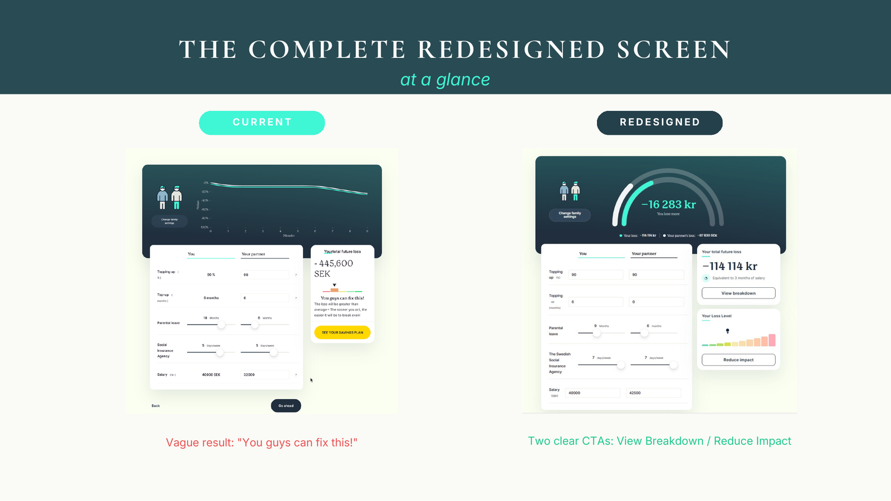
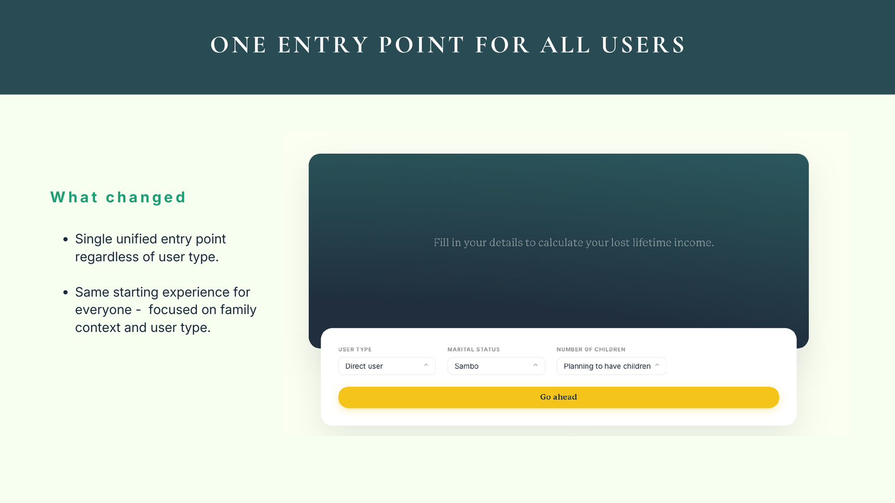
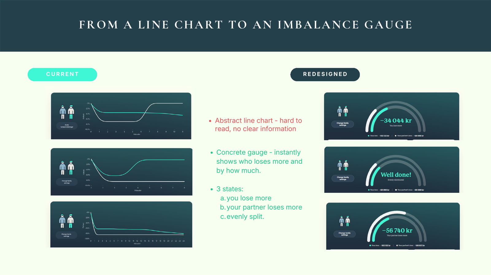
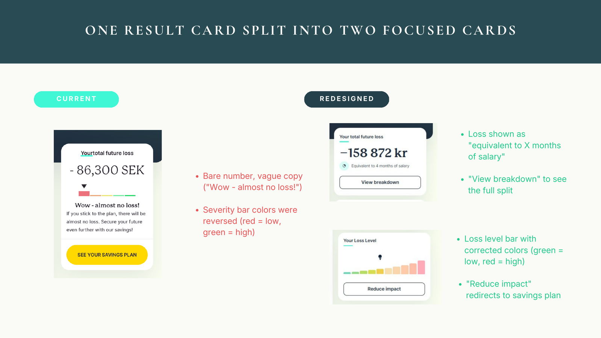
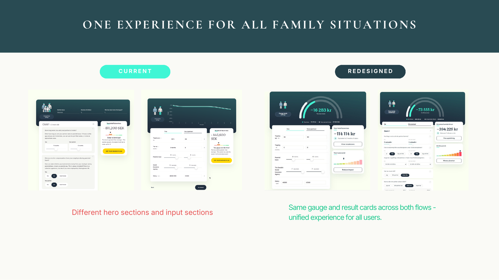
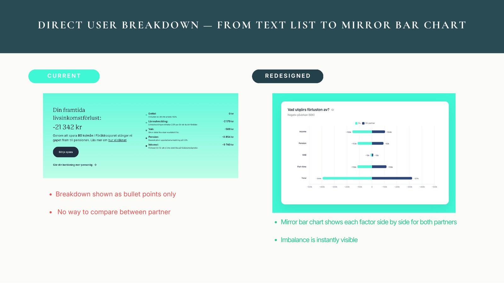
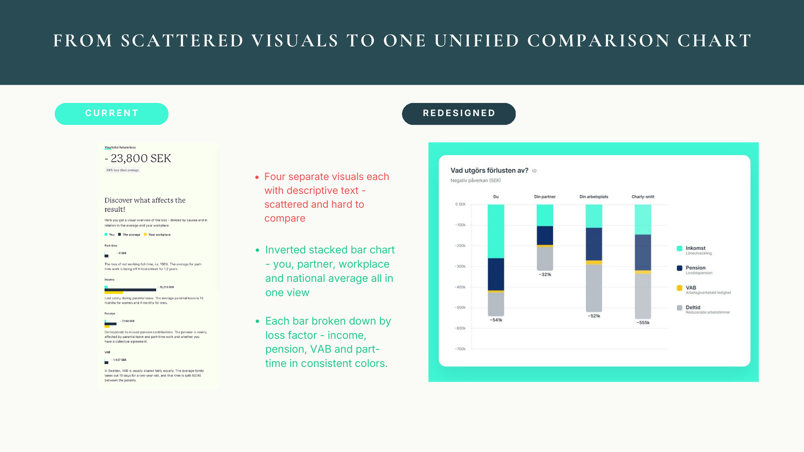
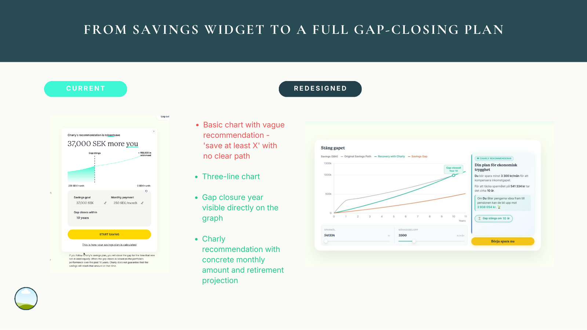

# Charly: Financial Insight Redesign

A data visualisation redesign for **Charly**, a Swedish fintech that shows working parents how parental leave affects their lifetime income and pension. Built as a Hyper Island client project.

**Hyper Island · Data Visualization · April–May 2026 · Client project · Team of four**

## The challenge

Charly turns complex financial data into a personal estimate of how much income and pension a parent loses through parental leave, and how a savings plan can close that gap. Users arrive in two ways, directly through the website or through their employer, and because the available data differs, the two groups received two different experiences.

The brief asked how to:
- **Make the total loss, and what it is made of, easy to understand**
- **Add meaningful comparisons**, such as a partner, the workplace and the national average
- **Show how saving closes the gap**, and why starting early matters
- **Bring both user groups into one consistent experience**

## What we changed

| | Before | After |
|---|---|---|
| **Entry** | Different starting flows per user type | One entry point for all users |
| **Headline result** | Abstract line chart of income over time | An imbalance gauge showing who loses more, and by how much |
| **Result card** | A bare number with vague copy ("Wow, almost no loss!") and reversed severity colours | Two focused cards: loss expressed as months of salary, and a loss-level bar with corrected colours |
| **Breakdown** | A text list with no way to compare partners | A mirror bar chart comparing both partners factor by factor |
| **Benchmarks** | Four separate visuals, each with its own text | One stacked chart: you, your partner, your workplace and the national average |
| **Savings** | "Save at least X" with no clear path | A gap-closing plan showing the year the gap closes and a concrete monthly amount |

## Before and after

**One entry point for all users**

**From a line chart to an imbalance gauge**

**One result card split into two focused cards**

**One experience for all family situations**

**From a text list to a mirror bar chart**

**From scattered visuals to one comparison chart**

**From a savings widget to a gap-closing plan**

## Design principles

- **Show the answer first:** each view leads with the one number that matters, then offers the breakdown
- **Make comparisons instant:** partners, workplace and national average sit on the same axis in the same colours
- **Use colour consistently:** one colour per loss factor (income, pension, VAB, part-time) across every chart, with green for low and red for high
- **End with an action:** every result leads to a next step ("View breakdown", "Reduce impact", "Start saving")

## My role

I owned the redesign within a team of four: the new visual concepts and the interactive prototype, built in HTML, CSS and JavaScript with Chart.js on top of Charly's existing page.

## About this repository

This is a portfolio case study. The prototype code, the client's brief and the client's data are not included, because the work and its results belong to Charly under the Hyper Island collaboration agreement. The images show the redesigned screens with example inputs.

All rights to the designs belong to Charly Tech AB. Shown here with the portfolio rights granted to the student team.

## Built with

HTML · CSS · JavaScript · Chart.js · data visualisation · UX design
